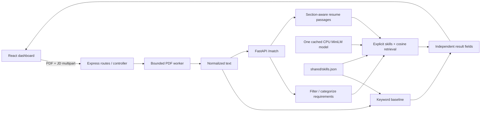

# Architecture and Sprint 3 decisions

## Responsibilities

- React `pages/` composes the workflow; `hooks/` owns request/form state; `services/` handles HTTP; `utils/` validates inputs and prioritizes result presentation; `components/` renders inputs, result summaries, coverage and native disclosures. Dark theme tokens/layout live in `index.css` and existing Tailwind utilities. No external font, icon package, animation library or fabricated metrics.
- Express `routes/` wires middleware and controllers. `validators/` checks multipart inputs and Python responses. `middleware/` bounds uploads/concurrency and handles safe errors. `services/` orchestrates extraction, unchanged keyword math and optional NLP. `config/` reads environment configuration. PDF geometry reconstruction stays in utilities/worker code and runs outside the main event loop.
- Python `app.py` owns lifespan/model reuse; `api/` owns HTTP; `schemas.py` defines request/response contracts; `models/` loads the model; `processing/` extracts and token-bounds text; `matching/` performs retrieval and hybrid assessment; `config.py` centralizes settings. Model loading still happens once per process, not per request.
- Shared JSON remains data, not a second service or generated copy. Technical systems aliases were added to the same existing taxonomy; Python reads it relative to its source tree and Express uses the same file.

## Compatibility and major moves

| Previous location | Current responsibility | Compatibility |
| --- | --- | --- |
| `client/src/App.jsx` | `pages/AnalyzerPage.jsx`, `hooks/useAnalysis.js`, `components/` | App stays the React entrypoint |
| `client/src/lib/analyzer.js` | `services/analyzer.js`, `utils/validation.js`, `config/index.js` | Original imports re-exported |
| `client/src/SemanticResults.jsx` | `components/analysis/RequirementGroups.jsx` | Original component export retained |
| Express inline upload/errors/validation | `middleware/`, `validators/`, `config/` | Same HTTP routes and keyword fields |
| Controller orchestration | `services/analyzeResume.js` | Controller handles validation/cancellation/response |
| `nlp/engine.py` | `processing/`, `matching/`, `config.py` | Existing Python symbols re-exported |
| `nlp/model.py` | `models/loader.py` | `load_engine` remains importable |
| Inline FastAPI endpoints/schemas | `api/`, `schemas.py` | `nlp.app:app`, URLs and raw retrieval fields preserved |

## Evidence semantics

`status` remains the legacy raw similarity signal to avoid silently redefining an existing API. `hybridStatus` is the new human-facing evidence assessment. Low cosine cannot erase an affirmative technical skill mention; high cosine cannot create an absent named skill. Exact evidence is tracked per skill and can cite different resume bullets. The selected primary passage favors actual named-skill overlap before cosine ranking, improving relevance in short technical requirements.

The human-facing classification is `evidenceKind`: explicit, contextual, uncertain, or not_evidenced. Legacy `hybridStatus` maps to supported, uncertain, or missing and remains compatible. Summaries count the final evidence kinds; raw cosine values cannot inflate supported counts. The UI groups by these final states and orders required before preferred/optional conditions, retaining technical/experience/education/other category labels.

`processing/conditions.py` parses explicit AND/OR skill groups, including repeated obligations and comma-OR lists. A satisfied OR group does not create gaps for unused alternatives. `processing/education.py` normalizes named engineering/science degree families and fields conservatively: B.Tech CSE can match B.Tech Computer Science as text, but completion, accreditation and eligibility are unverified; B.Sc does not automatically satisfy B.Tech. Complex equivalence clauses remain manual-review cases. `processing/passages.py` carries source sections and filters contact/hobby noise. Evidence that lacks relevance is flagged and never displayed as supporting text. The resume skill/topical index is computed once per request and reused for all requirements.

Markdown and plain-text JD sections are parsed before passage embedding. Role/team titles, employment metadata and company introductions are structural/contextual data. Meaningful uncertain items are retained with extraction notes; conflicting duplicate priorities remain visible. Generic qualifications headings do not imply mandatory status. Both API suggestions (`server/services/recommendations.js`) and dashboard presentation use actual extracted conditions, avoiding raw full-JD keyword terms as fabricated qualification gaps.

The original keyword denominator intentionally remains the full JD for API continuity. It is labelled as such in the UI: it can contain optional or company-context mentions, unlike the filtered requirement assessment. This distinction is important when a job posting names technologies outside its qualifications.

## Verification and operational boundary

Service-specific tests remain in `client/test`, `server/test`, and `nlp/tests`. `scripts/smoke_local.py` checks actual cached-model inference through a real PDF upload; its optional native Chrome runner also exercises the React form, Vite proxy, CORS, live summary counts, native keyboard/evidence expansion, replacement inputs, network/server failure and retry, and responsive reanalysis. Only generated test documents are saved for optional smoke artifacts. Normal user analysis is transient.

Local resource controls and V8 worker limits are not an OS security sandbox. Python inference is bounded by input/passage caps and a single inference lock; HTTP cancellation cannot interrupt an already-running CPU operation. Infrastructure resource limits and multi-user security remain future work.

Containerization is deferred. A later image/build must include `shared/` next to the Node and Python sources, provide/cache the pinned model, configure inter-service URLs and bind addresses, and supply OS memory/CPU limits. No compose files, Dockerfiles, AWS configuration or deployment steps are introduced here.

## Final local acceptance contract

No original API endpoint or keyword-result field was removed. `suggestions` remains a string array, now grounded in final requirements rather than raw JD terms. New evidence metadata is additive; Express rejects contradictory final classifications or incorrect missing-OR sets, and accepts legacy semantic responses without the new fields. React conservatively handles legacy results while keeping direct mentions distinct from verified ability. Native HTML disclosures and existing React/Tailwind tooling provide keyboard access without a UI library. Design tokens are centralized in `client/src/index.css`; there are no external fonts or analytics placeholders.

The browser runner uses only built-in Node/CDP APIs and an installed Chrome configured by `CHROME_BIN`. Generated PDF fixtures include a replacement resume and a deliberately malformed PDF. It intercepts one browser request to verify actual loading and another to exercise network failure, then retries against the real CPU service; no fabricated analysis payload is injected. All temporary processes/profiles are cleaned up. Local readiness does not imply public multi-user deployment readiness.
